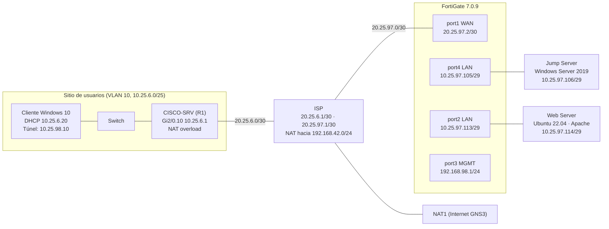
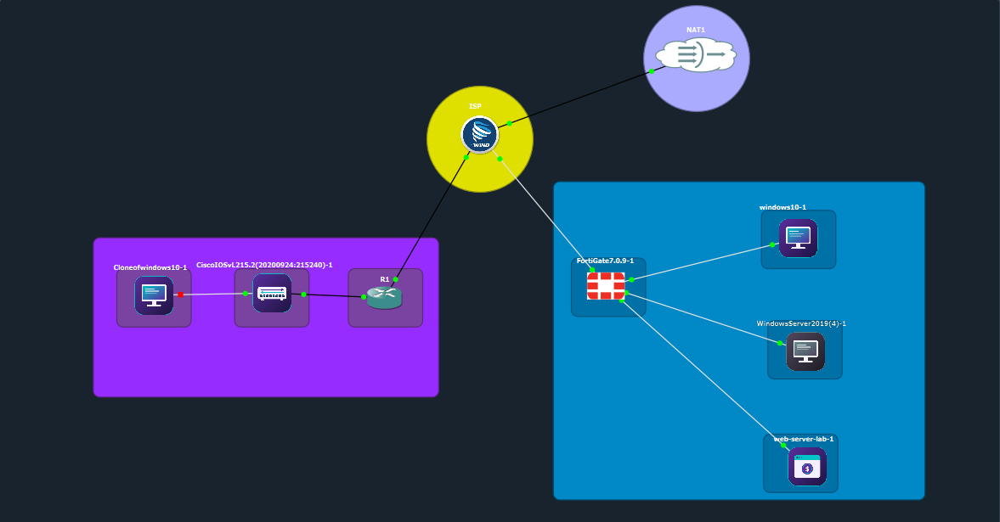

# Práctica 1 — Seguridad perimetral con FortiGate, VPN Remote-Site y Jump Server

Laboratorio de segmentación de red y acceso remoto controlado: un FortiGate protege dos servidores (Jump Server y Web Server), una VPN IPsec de acceso remoto permite llegar **únicamente** al Jump Server, y el Jump publica aplicaciones mediante RemoteApp de forma diferenciada según el perfil del usuario.

**Autor:** `Emely carrasco` · **Asignatura:** `SA` · **Fecha de las evidencias:** 09/10/2026

---

## Video demostrativo

> **Enlace pendiente.** El video aún no ha sido publicado y no se incluye un enlace inventado.
> Cuando esté disponible, reemplazar esta línea por el enlace real y completar la tabla de minutaje.
> Instrucciones en [`video/README.md`](video/README.md).

| Minuto | Prueba mostrada |
|---|---|
| `[pendiente]` | Conexión de la VPN con FortiClient |
| `[pendiente]` | Acceso a RD Web con usuario sin privilegios (solo Firefox) |
| `[pendiente]` | Acceso a RD Web con usuario con privilegios (Firefox, PuTTY, RDP) |
| `[pendiente]` | Jump → Web por HTTPS, SSH y RDP |
| `[pendiente]` | Denegaciones y logs del FortiGate |

---

## Índice

1. [Descripción del laboratorio](#descripción-del-laboratorio)
2. [Arquitectura](#arquitectura)
3. [Objetivos](#objetivos)
4. [Tecnologías identificadas](#tecnologías-identificadas)
5. [Funcionalidades verificadas](#funcionalidades-verificadas)
6. [Pruebas y estado de cumplimiento](#pruebas-y-estado-de-cumplimiento)
7. [Documentación y archivos](#documentación-y-archivos)
8. [Limitaciones y pendientes](#limitaciones-y-pendientes)
9. [Conclusiones](#conclusiones)

---

## Descripción del laboratorio

Se plantea un escenario donde un usuario remoto necesita administrar un servidor web sin exponerlo directamente. La solución aplica tres capas de control independientes:

| Capa | Mecanismo | Qué controla |
|---|---|---|
| Red | Políticas del FortiGate | Qué origen alcanza qué destino y por qué servicio |
| Acceso remoto | VPN IPsec + autenticación de usuarios del FortiGate | Quién entra al túnel |
| Aplicación | RemoteApp en el Jump Server | Qué aplicaciones ve cada perfil de usuario |

El flujo previsto es: **Cliente remoto → VPN → Jump Server → Web Server**. El cliente nunca debe alcanzar el Web Server directamente. Detalle en [`docs/02-arquitectura.md`](docs/02-arquitectura.md).

## Arquitectura

- Los dos servidores están en **LAN separadas** (cada una un /29) conectadas a puertos distintos del FortiGate, de modo que todo el tráfico Jump ↔ Web atraviesa el firewall.
- Diagramas de flujo y de control de acceso: [`docs/02-arquitectura.md`](docs/02-arquitectura.md). Código fuente editable en [`diagrams/`](diagrams/).

## Objetivos

**General.** Implementar y documentar una infraestructura segmentada en la que el acceso remoto por VPN esté limitado a un Jump Server y los permisos de los usuarios se diferencien por perfil.

**Específicos.**
1. Configurar interfaces, enrutamiento y objetos del FortiGate mediante la GUI.
2. Establecer una VPN IPsec de acceso remoto con autenticación de usuarios.
3. Restringir el acceso VPN al Jump Server mediante políticas.
4. Permitir al Jump únicamente HTTPS, RDP y SSH hacia el Web Server.
5. Publicar Firefox, PuTTY y Conexión a Escritorio remoto con RemoteApp según el perfil.
6. Entregar DHCP en la VLAN 10 (/25) mediante un equipo Cisco.

## Tecnologías identificadas

Solo se listan las que aparecen en las evidencias.

| Componente | Tecnología / versión | Evidencia |
|---|---|---|
| Firewall | FortiGate, etiqueta de nodo `FortiGate7.0.9` | [RED-01](evidencias/red/RED-01-topologia-gns3.png) |
| Emulación | GNS3 | [RED-01](evidencias/red/RED-01-topologia-gns3.png) |
| Router ISP y Cisco-SRV | Cisco IOS 15.2 (IOSvL2 / IOSv) | [`configs/equipo-red/`](configs/equipo-red/) |
| Cliente VPN | FortiClient (VPN) | [VPN-02](evidencias/vpn/VPN-02-forticlient-conectado.png) |
| Jump Server | Windows Server 2019, AD DS, DNS, IIS, RDS | [RDS-01](evidencias/jump-server/RDS-01-rol-rds.png) · [RDS-08](evidencias/remoteapp/RDS-08-rdweb-login-usr-priv.png) |
| Web Server | Ubuntu 22.04.5 LTS, Apache/2.4.52, OpenSSH, xrdp | [TEST-05](evidencias/pruebas-permitidas/TEST-05-jump-a-web-https-curl.png) · [TEST-08](evidencias/pruebas-permitidas/TEST-08-jump-a-web-ssh-putty.png) · [RED-05](evidencias/red/RED-05-xrdp-3389-web.png) |
| Cliente | Windows 10 (build 10.0.19045) | [TEST-01](evidencias/pruebas-permitidas/TEST-01-vpn-a-jump-443-3389.png) |

## Funcionalidades verificadas

| Funcionalidad | Estado | Evidencia principal |
|---|---|---|
| Direccionamiento de interfaces y ruta por defecto en FortiGate | Demostrado | [FW-01](evidencias/fortigate/FW-01-interfaces.png), [FW-02](evidencias/fortigate/FW-02-ruta-estatica.png) |
| VPN IPsec establecida | Demostrado | [VPN-02](evidencias/vpn/VPN-02-forticlient-conectado.png), [VPN-03](evidencias/vpn/VPN-03-monitor-ipsec.png) |
| VPN → Jump por HTTPS y RDP | Demostrado | [TEST-01](evidencias/pruebas-permitidas/TEST-01-vpn-a-jump-443-3389.png) |
| Jump → Web por SSH | Demostrado | [TEST-08](evidencias/pruebas-permitidas/TEST-08-jump-a-web-ssh-putty.png) |
| Jump → Web por HTTPS | Demostrado | [TEST-05](evidencias/pruebas-permitidas/TEST-05-jump-a-web-https-curl.png) |
| SSH denegado al Jump para el perfil básico | Demostrado | [TEST-10](evidencias/pruebas-denegadas/TEST-10-basico-ssh-jump-denegado-log.png) |
| RemoteApp diferenciado por grupo | Parcialmente demostrado | [RDS-04](evidencias/remoteapp/RDS-04-firefox-asignacion.png), [RDS-09](evidencias/remoteapp/RDS-09-rdweb-tres-aplicaciones.png) |

## Pruebas y estado de cumplimiento

Resumen. La matriz completa con procedimiento está en [`matrices/matriz-validacion.md`](matrices/matriz-validacion.md).

| ID | Requisito | Resultado observado | Estado | Evidencia |
|---|---|---|---|---|
| T03 | VPN establecida | FortiClient conectado con 10.25.98.10; túnel activo en el monitor IPsec | Aprobada | [VPN-02](evidencias/vpn/VPN-02-forticlient-conectado.png) · [VPN-03](evidencias/vpn/VPN-03-monitor-ipsec.png) |
| T04 | VPN → Jump | TCP 443 y 3389 abiertos con origen 10.25.98.10 | Aprobada | [TEST-01](evidencias/pruebas-permitidas/TEST-01-vpn-a-jump-443-3389.png) |
| T05 | VPN → Web denegado | Las pruebas existentes salieron por la LAN (10.25.6.20), no por el túnel | Aprobada | — |
| T06 | Jump → Web HTTPS | HTTP/1.1 200 OK desde el Jump | Aprobada | [TEST-05](evidencias/pruebas-permitidas/TEST-05-jump-a-web-https-curl.png) |
| T07 | Jump → Web RDP | TCP 3389 abierto y xrdp escuchando| Parcial | [TEST-04](evidencias/pruebas-permitidas/TEST-04-jump-a-web-tcp-443-22-3389.png) |
| T08 | Jump → Web SSH | Sesión SSH como `webadmin` | Aprobada | [TEST-08](evidencias/pruebas-permitidas/TEST-08-jump-a-web-ssh-putty.png) |
| T13 | Básico SSH → Jump denegado | Log "Deny: policy violation" en DENY-SSH-BASICO-JUMP | Aprobada | [TEST-10](evidencias/pruebas-denegadas/TEST-10-basico-ssh-jump-denegado-log.png) |
| T14 | Básico SSH → Web denegado | Aprobada | — |
| T17 | Sistema de Caja | El Web muestra la página por defecto de Apache | Aprobada | [TEST-07](evidencias/pruebas-permitidas/TEST-07-jump-a-web-navegador-https.png) |

## Documentación y archivos

| Carpeta / archivo | Contenido |
|---|---|
| [`docs/01-introduccion-y-objetivos.md`](docs/01-introduccion-y-objetivos.md) | Propósito, alcance y requisitos |
| [`docs/02-arquitectura.md`](docs/02-arquitectura.md) | Topología, flujo de tráfico y control de acceso |
| [`docs/03-direccionamiento-y-red.md`](docs/03-direccionamiento-y-red.md) | Interfaces, rutas, DHCP, NAT |
| [`docs/04-vpn-remote-site.md`](docs/04-vpn-remote-site.md) | Configuración y estado de la VPN |
| [`docs/05-jump-server-y-remoteapp.md`](docs/05-jump-server-y-remoteapp.md) | RDS, RemoteApp y grupos |
| [`docs/06-politicas-seguridad.md`](docs/06-politicas-seguridad.md) | Políticas, objetos y servicios |
| [`docs/07-pruebas-validacion.md`](docs/07-pruebas-validacion.md) | Pruebas con evidencia y análisis |
| [`docs/08-limitaciones-y-pendientes.md`](docs/08-limitaciones-y-pendientes.md) | Hallazgos, riesgos y faltantes |
| [`docs/09-conclusiones.md`](docs/09-conclusiones.md) | Conclusiones |
| [`matrices/`](matrices/) | Direccionamiento, políticas y validación |
| [`evidencias/INVENTARIO.md`](evidencias/INVENTARIO.md) | Inventario de capturas |
| [`configs/`](configs/) | Running-configs (redactadas) |
| [`scripts/`](scripts/) | Comandos de prueba empleados (no hay scripts propios) |
| [`diagrams/`](diagrams/) | Fuentes Mermaid |

## Conclusiones

La infraestructura base está implementada y la mayor parte de la cadena Cliente → VPN → Jump → Web está respaldada por evidencia. La separación de perfiles a nivel de aplicación (RemoteApp) y el bloqueo SSH del perfil básico hacia el Jump están demostrados. La restricción central de la práctica, **VPN sin acceso directo al Web Server**, y la publicación real del Sistema de Caja están demostrados. Ver [`docs/09-conclusiones.md`](docs/09-conclusiones.md).
