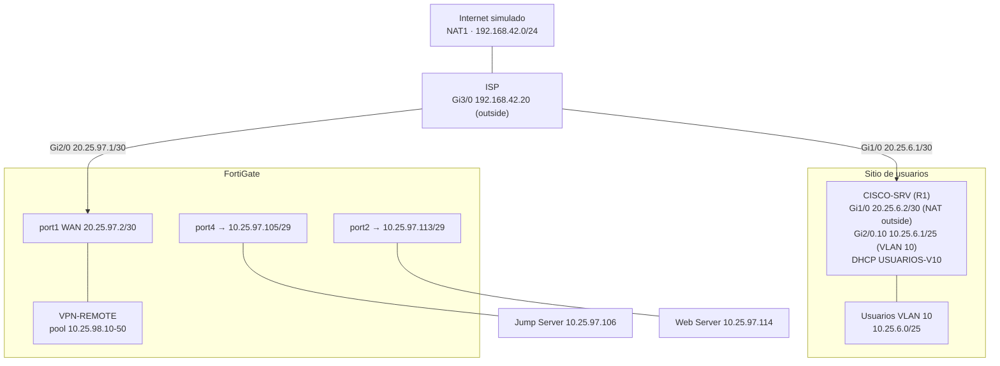
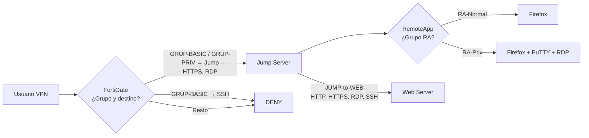

# 02 · Arquitectura

## Topología observada

*RED-01. Topología en GNS3: ISP conectado a NAT1, a R1 (lado Cisco con switch y cliente Windows 10) y al FortiGate 7.0.9, del que cuelgan un Windows 10, un Windows Server 2019 y el Web Server.*

Se puede verificar: nodos y enlaces. **No** se puede concluir solo con esta captura: direcciones, VLAN ni la función del Windows 10 conectado al FortiGate (probablemente gestión por el puerto MGMT; no hay evidencia, queda por confirmar).

## Diagrama lógico



## Flujo de tráfico previsto

```mermaid
sequenceDiagram
    participant C as Cliente (10.25.6.20)
    participant R as CISCO-SRV (NAT)
    participant I as ISP (NAT)
    participant F as FortiGate
    participant J as Jump 10.25.97.106
    participant W as Web 10.25.97.114
    C->>R: IKE/ESP hacia 20.25.97.2
    R->>I: origen NAT 20.25.6.2
    I->>F: origen NAT visto como 20.25.6.2
    F-->>C: Túnel; cliente recibe 10.25.98.x
    C->>J: HTTPS (RD Web) / RDP vía túnel
    Note over F: BASICO-to-JUMP / PRIV-to-JUMP
    J->>W: HTTPS, RDP, SSH
    Note over F: JUMP-to-WEB
    C--xW: Directo desde VPN: sin política que lo permita
```

El peer remoto aparece en el monitor IPsec como `20.25.6.2` ([VPN-03](../evidencias/vpn/VPN-03-monitor-ipsec.png)), coherente con el NAT *overload* de CISCO-SRV.

## Control de acceso (modelo en capas)



> Nota: BASICO-to-JUMP y PRIV-to-JUMP permiten los **mismos servicios** (HTTPS y RDP). La diferencia de privilegios entre perfiles recae en **RemoteApp**, no en el firewall. Ver [06](06-politicas-seguridad.md).

## Límites de confianza
| Zona | Confianza | Control en el límite |
|---|---|---|
| Sitio de usuarios / Internet | No confiable | Autenticación VPN |
| Túnel VPN | Parcial | Políticas `VPN-REMOTE → port4` |
| LAN Jump (port4) | Media | Políticas `JUMP-to-WEB` |
| LAN Web (port2) | Alta | Solo desde H-JUMP |
