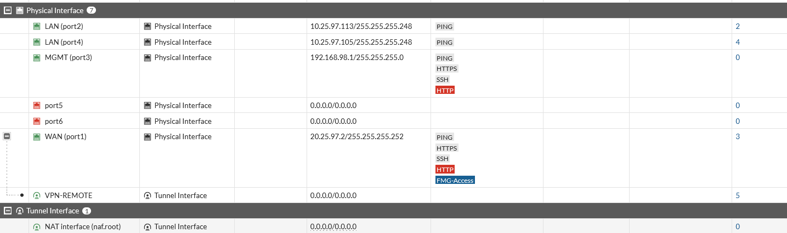
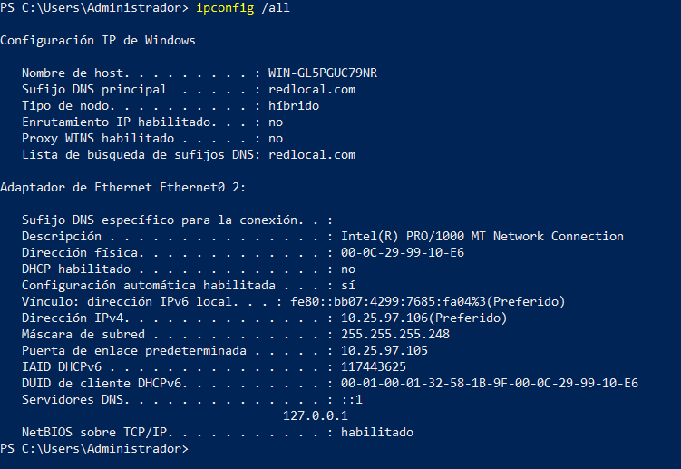
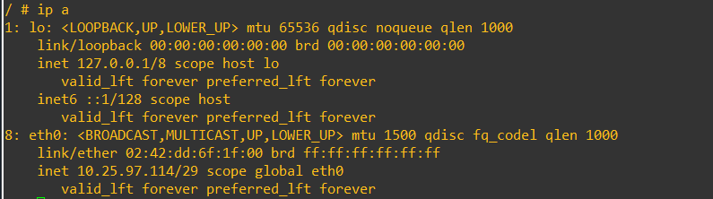

# 03 · Direccionamiento y configuración de red

## Plan de direccionamiento
La tabla consolidada está en [`matrices/direccionamiento-ip.md`](../matrices/direccionamiento-ip.md).

## FortiGate

*FW-01. Interfaces físicas del FortiGate.*

| Interfaz | Rol | Dirección | Acceso administrativo habilitado |
|---|---|---|---|
| port1 | WAN | 20.25.97.2/30 | PING, HTTPS, SSH, HTTP, FMG-Access |
| port2 | LAN (Web) | 10.25.97.113/29 | PING |
| port4 | LAN (Jump) | 10.25.97.105/29 | PING |
| port3 | MGMT | 192.168.98.1/24 | PING, HTTPS, SSH, HTTP |
| port5, port6 | Sin uso | 0.0.0.0/0 | — |
| VPN-REMOTE | Interfaz de túnel (sobre port1) | — | — |

**Resultado.** Cada servidor tiene su propia LAN /29 detrás de un puerto distinto, por lo que el tráfico Jump ↔ Web debe atravesar el firewall.
**Observación de seguridad.** HTTP, HTTPS, SSH y FMG-Access están habilitados en la interfaz WAN, y HTTP en MGMT. Es una exposición administrativa innecesaria; ver [08](08-limitaciones-y-pendientes.md).

*FW-02. Ruta por defecto 0.0.0.0/0 vía 20.25.97.1 por WAN (port1), habilitada.*

## ISP
Archivo: [`configs/equipo-red/ISP-running-config.txt`](../configs/equipo-red/ISP-running-config.txt).

| Interfaz | Descripción | Dirección | NAT |
|---|---|---|---|
| Gi1/0 | HACIA-CISCO-USR | 20.25.6.1/30 | inside |
| Gi2/0 | HACIA-FORTIGATE | 20.25.97.1/30 | inside |
| Gi3/0 | hacia el internet | 192.168.42.20/24 | outside |

NAT *overload* por Gi3/0 para 20.25.97.0/30 y 20.25.6.0/30; ruta por defecto 0.0.0.0/0 vía 192.168.42.1.

## CISCO-SRV (R1): VLAN 10, DHCP y NAT
Archivo: [`configs/equipo-red/CISCO-SRV-running-config.redactado.txt`](../configs/equipo-red/CISCO-SRV-running-config.redactado.txt). El archivo original se llamaba `Running-Config_R1.txt`, pero el hostname es `CISCO-SRV`.

| Elemento | Configuración |
|---|---|
| WAN | Gi1/0 20.25.6.2/30, `ip nat outside` |
| VLAN 10 | Gi2/0.10, `encapsulation dot1Q 10`, 10.25.6.1/25 |
| DHCP | Pool `USUARIOS-V10`, red 10.25.6.0/25, gateway 10.25.6.1, DNS 8.8.8.8, excluidas .1–.10 |
| NAT | `ip nat inside source list 1 interface Gi1/0 overload` (ACL 1: 10.25.6.0/25) |
| Ruta | 0.0.0.0/0 vía 20.25.6.1 |
| Gestión | SSH v2 únicamente, usuario local, `login local` |

**Verificación en cliente.** El cliente obtiene `10.25.6.20/255.255.255.128`, gateway `10.25.6.1` ([VPN-04](../evidencias/vpn/VPN-04-ip-cliente-vpn.png), [TEST-12](../evidencias/pruebas-denegadas/TEST-12-cliente-lan-a-web-no-concluyente.png)). La dirección y la máscara coinciden con el pool, pero **ninguna captura muestra el indicador "DHCP habilitado" ni la tabla de concesiones** (`show ip dhcp binding`). Estado: **Parcial**.

## Servidores

*RED-02. Jump Server: 10.25.97.106/255.255.255.248, gateway 10.25.97.105, IP estática, DNS 127.0.0.1 y ::1.*

*RED-03. Web Server: `eth0` 10.25.97.114/29.*

El gateway del Web Server (10.25.97.113) no aparece en ninguna captura; no se declara como verificado.

## Pruebas de conectividad base (ISP/FortiGate/Cisco)
No hay capturas de `ping` entre ISP, FortiGate y CISCO-SRV. La conectividad se infiere de forma indirecta (el túnel IPsec se establece a través de ambos NAT), pero **no está demostrada directamente**. Estado: **Parcial (indirecta)**.
