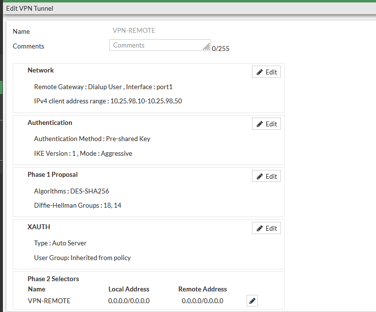
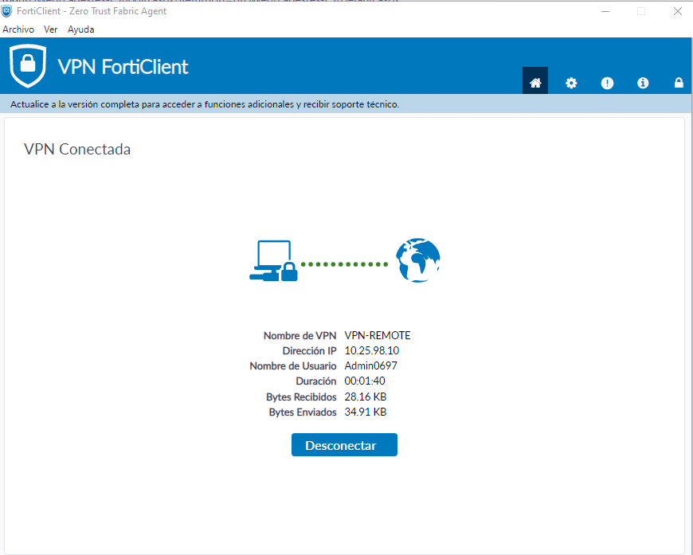
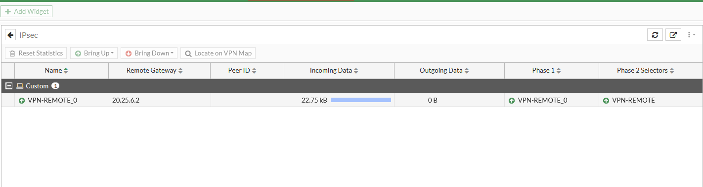
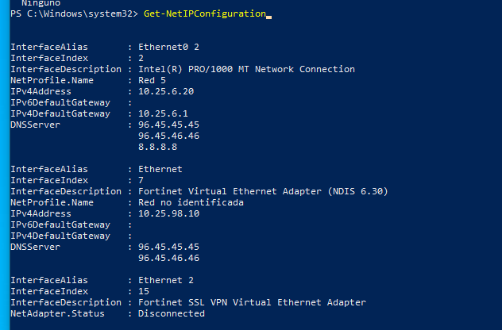

# 04 · VPN Remote-Site

## Configuración observada

*VPN-01. Resumen del túnel `VPN-REMOTE` en la GUI del FortiGate.*

| Parámetro | Valor observado |
|---|---|
| Tipo de gateway remoto | Dialup User, interfaz port1 |
| Rango de clientes | 10.25.98.10 – 10.25.98.50 (objeto `NET-VPN-POOL`) |
| Autenticación | Clave precompartida (PSK) |
| IKE | Versión 1, modo Aggressive |
| Fase 1 | DES-SHA256; grupos DH 18 y 14 |
| XAUTH | Auto Server; grupo heredado de la política |
| Fase 2 | Selector `VPN-REMOTE`, local 0.0.0.0/0, remoto 0.0.0.0/0 |

## Establecimiento

*VPN-02. FortiClient: VPN-REMOTE conectada, IP 10.25.98.10, usuario Admin0697, duración 00:01:40.*

*VPN-03. Monitor IPsec: `VPN-REMOTE_0`, gateway remoto 20.25.6.2, Fase 1 y Fase 2 activas.*

El gateway remoto 20.25.6.2 corresponde a la WAN de CISCO-SRV: el cliente atraviesa dos NAT hasta llegar al FortiGate.

## Configuración IP del cliente con el túnel activo

## Autenticación de usuarios del túnel
Los usuarios del FortiGate son locales ([FW-07](../evidencias/usuarios/FW-07-usuarios-locales.png)), sin autenticación de dos factores:

| Usuario | Grupos | Perfil |
|---|---|---|
| Admin0697 | GRUP-PRIV, GRUP-VPN | Con privilegios |
| Emely | GRUP-BASIC, GRUP-VPN | Sin privilegios |
| guest | Guest-group | No utilizado en la práctica |

`GRUP-VPN` aparece con referencia 0 en [FW-06](../evidencias/usuarios/FW-06-grupos-usuarios.png): ninguna política lo usa; la autorización efectiva la realizan GRUP-BASIC y GRUP-PRIV.

