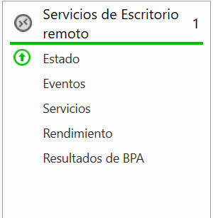
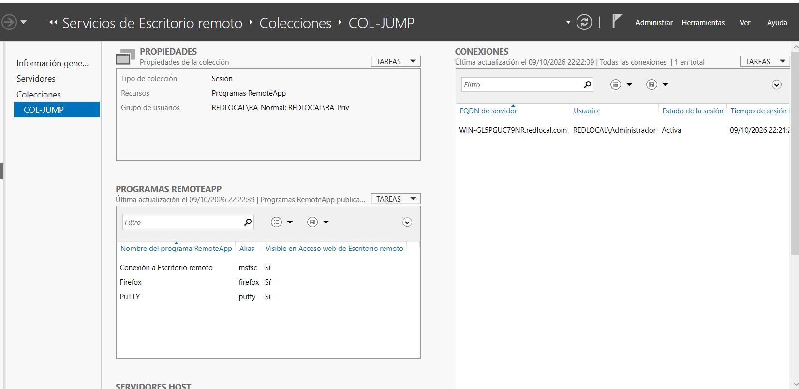
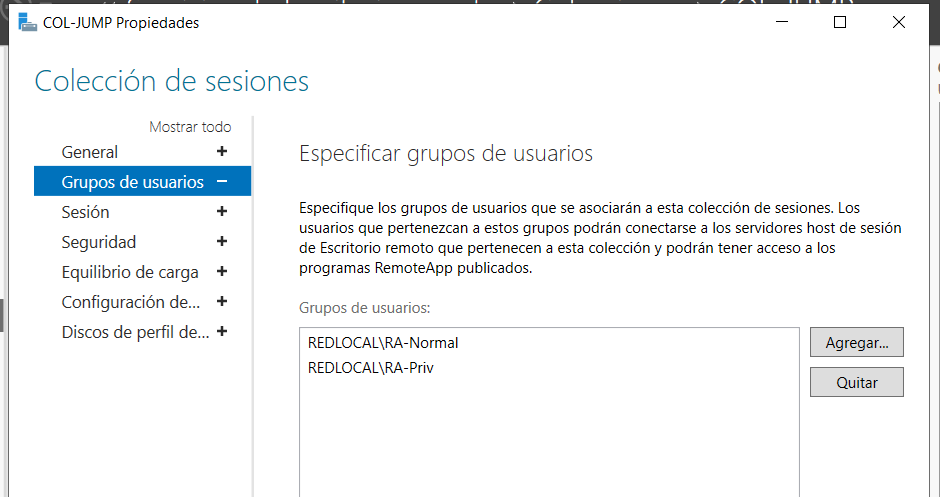
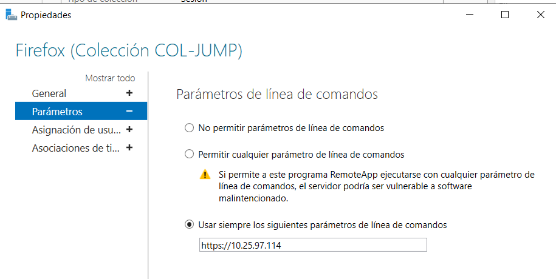
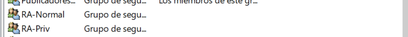
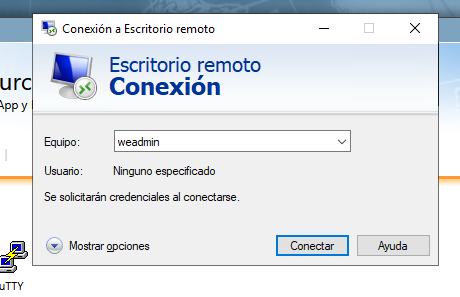
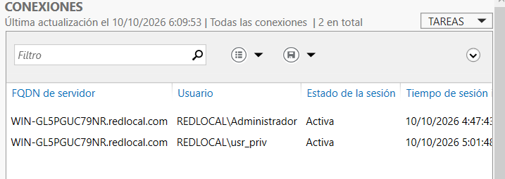
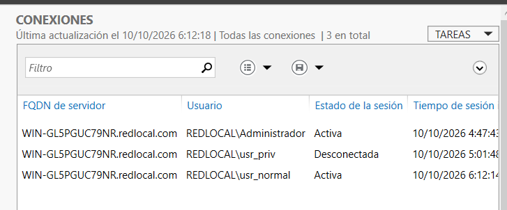

# 05 · Jump Server y RemoteApp

## Roles y servicios

*RDS-01. Rol "Servicios de Escritorio remoto" presente en el Administrador del servidor.*

El Administrador del servidor del Jump muestra además AD DS, DNS, IIS y Servicios de archivos ([TEST-11](../evidencias/pruebas-denegadas/TEST-11-jump-a-web-445-no-concluyente.png)). Su DNS es 127.0.0.1, por lo que el Jump es también **controlador de dominio** (`redlocal.com`). Es una limitación de diseño; ver [08](08-alcance-y-trabajo-futuro.md).

## Colección COL-JUMP

*RDS-02. Colección de sesión COL-JUMP con RemoteApp: Conexión a Escritorio remoto (mstsc), Firefox y PuTTY, los tres visibles en Acceso web.*

*RDS-03. Grupos asociados a la colección: REDLOCAL\RA-Normal y REDLOCAL\RA-Priv.*

## Publicación por perfil (Capa 1: RemoteApp)

| Aplicación | RA-Normal | RA-Priv | Evidencia |
|---|---|---|---|
| Firefox | Sí | Sí | [RDS-04](../evidencias/remoteapp/RDS-04-firefox-asignacion.png) |
| PuTTY | No | Sí | [RDS-06](../evidencias/remoteapp/RDS-06-putty-asignacion.png) |
| Conexión a Escritorio remoto | No | Sí | [RDS-07](../evidencias/remoteapp/RDS-07-mstsc-asignacion.png) |

Cada aplicación está limitada a "Solo los usuarios y grupos especificados".

*RDS-05. Firefox se inicia siempre con el parámetro `https://10.25.97.114`: el perfil básico llega al Web Server mediante esta aplicación.*

> El parámetro fijo evita que el usuario pase otros argumentos, pero **no impide navegar a otras direcciones** desde Firefox una vez abierto. Con el firewall, el único destino alcanzable desde el Jump hacia el Web son HTTP/HTTPS/RDP/SSH.

## Grupos y usuarios del dominio (Capa 2: permisos)

*AD-01. Grupos de seguridad RA-Normal y RA-Priv.*

| Grupo | Miembro observado | Evidencia |
|---|---|---|
| RA-Priv | Alicia (cuenta de dominio) | [AD-03](../evidencias/usuarios/AD-03-miembros-ra-priv.png) |
| RA-Normal | Emely (cuenta de dominio) | [AD-04](../evidencias/usuarios/AD-04-miembros-ra-normal.png) |

**Pendiente de aclarar.** Las pantallas de RD Web usan los inicios de sesión `usr_priv` y `usr_normal`. Es razonable que correspondan a Alicia y Emely, pero ninguna captura muestra el "nombre de inicio de sesión" de esas cuentas. Hasta tenerla, la vinculación se marca como **no verificada**. Además, el FortiGate usa nombres distintos (Admin0697, Emely): son dos sistemas de identidad sin vínculo técnico entre sí.

## Acceso web (RD Web Access)
| Usuario | Captura de inicio de sesión | Aplicaciones visibles |
|---|---|---|
| `usr_priv` | [RDS-08](../evidencias/remoteapp/RDS-08-rdweb-login-usr-priv.png) | [RDS-09](../evidencias/remoteapp/RDS-09-rdweb-tres-aplicaciones.png): mstsc, Firefox, PuTTY |
| `usr_normal` | [RDS-10](../evidencias/remoteapp/RDS-10-rdweb-login-usr-normal.png) | [RDS-11](../evidencias/remoteapp/RDS-11-rdweb-solo-firefox-a.png) / [RDS-12](../evidencias/remoteapp/RDS-12-rdweb-solo-firefox-b.png): solo Firefox |

**Límite de la evidencia.** Las pantallas de aplicaciones no muestran con qué usuario se inició sesión; la asociación usuario ↔ iconos se infiere de la secuencia de capturas. Estado: **Parcial**.

**RemoteApp Web Client.** Lo mostrado es RD Web Access clásico (`/RDWeb/Pages/es-ES/`) de Windows Server 2019. Si la práctica exige el cliente web HTML5 (`/RDWeb/webclient`), no hay evidencia de él.

## Conexión a Escritorio remoto publicada

*RDS-13. Cuadro de mstsc con el campo "Equipo" = `weadmin`. Ese valor no es una IP ni un hostname resoluble (el usuario del Web se llama `webadmin`). No demuestra una sesión RDP.*

## Sesiones activas en la colección

*RDS-14. Panel Conexiones de COL-JUMP: `REDLOCAL\usr_priv` con sesión activa.*

*RDS-15. `REDLOCAL\usr_normal` activa y `usr_priv` desconectada.*

Confirman que ambas cuentas inician sesión en la colección. Siguen sin mostrar qué iconos ve cada una; esa asociación se basa en la secuencia de capturas. La relación `usr_priv`/`usr_normal` con Alicia y Emely tampoco está demostrada.
