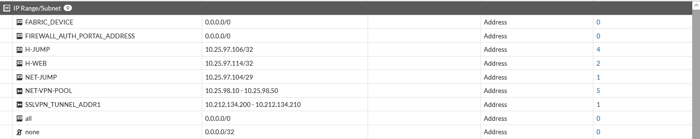
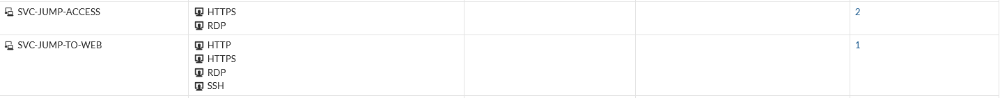
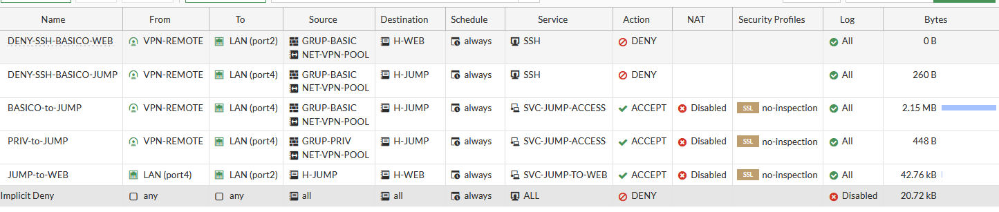

# 06 · Políticas de seguridad

## Objetos

*FW-03. Direcciones: H-JUMP 10.25.97.106/32, H-WEB 10.25.97.114/32, NET-JUMP 10.25.97.104/29, NET-VPN-POOL 10.25.98.10–10.25.98.50.*

No existe un objeto para la red del Web (10.25.97.112/29); se usa solo el host H-WEB.

## Servicios personalizados

*FW-04.*

| Servicio | Protocolos | Uso |
|---|---|---|
| SVC-JUMP-ACCESS | HTTPS, RDP | VPN → Jump |
| SVC-JUMP-TO-WEB | HTTP, HTTPS, RDP, SSH | Jump → Web |

## Políticas

*FW-05. Orden de evaluación, de arriba abajo.*

| # | Nombre | Desde → Hacia | Origen | Destino | Servicio | Acción | Bytes |
|---|---|---|---|---|---|---|---|
| 1 | DENY-SSH-BASICO-WEB | VPN-REMOTE → port2 | GRUP-BASIC + NET-VPN-POOL | H-WEB | SSH | DENY | 0 B |
| 2 | DENY-SSH-BASICO-JUMP | VPN-REMOTE → port4 | GRUP-BASIC + NET-VPN-POOL | H-JUMP | SSH | DENY | 260 B |
| 3 | BASICO-to-JUMP | VPN-REMOTE → port4 | GRUP-BASIC + NET-VPN-POOL | H-JUMP | SVC-JUMP-ACCESS | ACCEPT | 2.15 MB |
| 4 | PRIV-to-JUMP | VPN-REMOTE → port4 | GRUP-PRIV + NET-VPN-POOL | H-JUMP | SVC-JUMP-ACCESS | ACCEPT | 448 B |
| 5 | JUMP-to-WEB | port4 → port2 | H-JUMP | H-WEB | SVC-JUMP-TO-WEB | ACCEPT | 42.76 kB |
| — | Implicit Deny | any → any | all | all | ALL | DENY | 20.72 kB |

Las políticas ACCEPT tienen NAT deshabilitado y perfil `no-inspection`. Los números de la primera columna son el orden visual; los ID reales que muestra el log son `DENY-SSH-BASICO-JUMP (1)`, `BASICO-to-JUMP (3)` y `JUMP-to-WEB (5)`.

## Análisis técnico

1. **El aislamiento del Web depende de la ausencia de política y del Implicit Deny.** No hay una política `VPN → Web` que permita tráfico, por lo que, con origen en el túnel, el Web debe ser inalcanzable. Falta la prueba (T05).
2. **Los dos perfiles reciben el mismo acceso de red al Jump** (HTTPS y RDP). La diferencia de privilegios es de RemoteApp. Un usuario básico con acceso TCP a 3389 podría intentar una sesión RDP directa; qué ocurre depende de los derechos de inicio de sesión en el Jump. No hay prueba de ello (T18).
3. **SSH de Emely**: el bloqueo hacia el Jump está evidenciado ([TEST-10](../evidencias/pruebas-denegadas/TEST-10-basico-ssh-jump-denegado-log.png)); el de hacia el Web no (0 B).
4. **El Implicit Deny no registra** (Log deshabilitado); las denegaciones por política implícita no dejan rastro. Se recomienda activar el registro desde la GUI.
5. **Política de privilegiados.** PRIV-to-JUMP no tiene una política equivalente de DENY SSH, pero tampoco permite SSH: el servicio SVC-JUMP-ACCESS solo incluye HTTPS y RDP. Que el perfil con privilegios use PuTTY se hace **desde el Jump** hacia el Web (JUMP-to-WEB).
