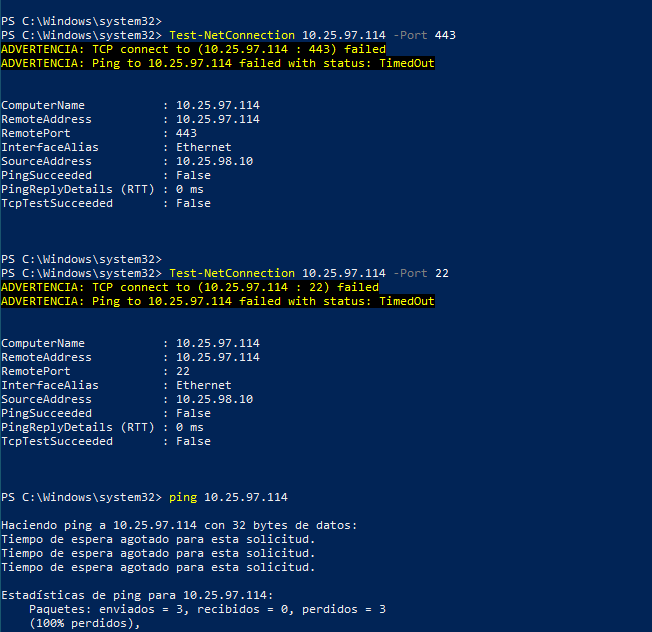
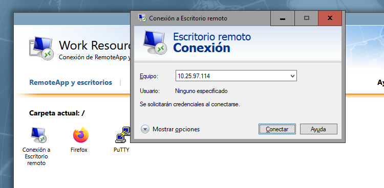
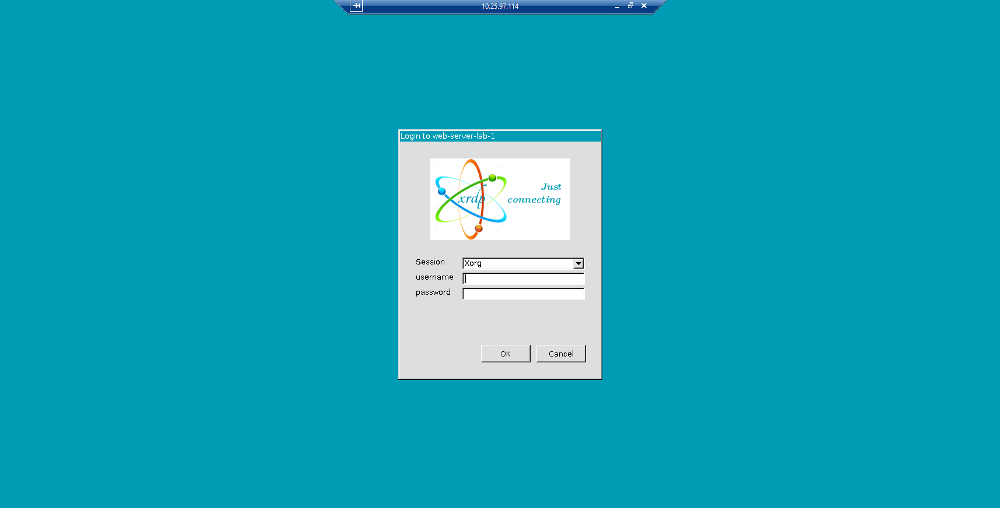
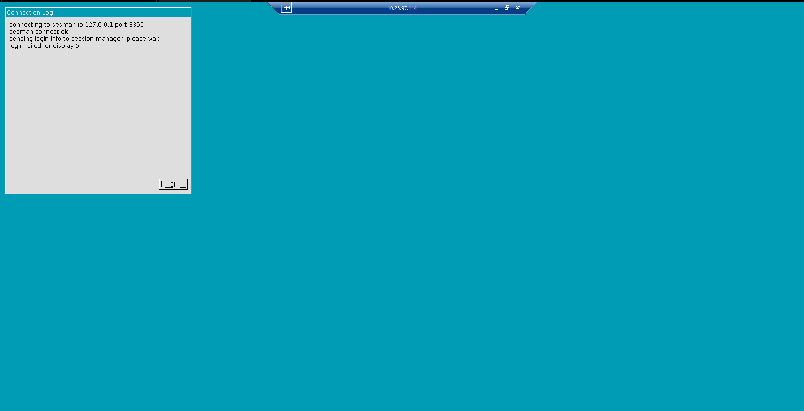
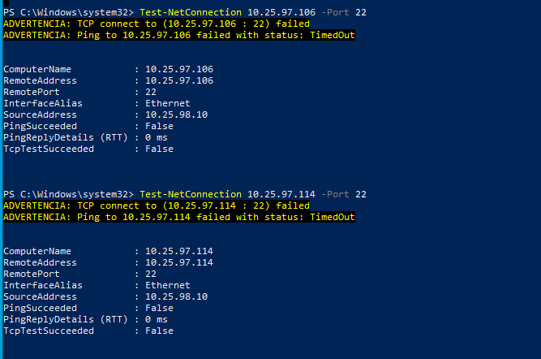

# 07 · Pruebas y validación

Estados: **Aprobada** (evidencia suficiente) · **Parcial** · **Ejecutada, no concluyente** (se hizo, pero no demuestra el requisito) · **Pendiente**. Tabla resumen: [`matrices/matriz-validacion.md`](../matrices/matriz-validacion.md).

## Acceso VPN

### T03 · Establecimiento de la VPN: Aprobada
- **Origen / destino:** cliente Windows 10 → FortiGate (20.25.97.2).
- **Resultado observado:** FortiClient conectado con 10.25.98.10 ([VPN-02](../evidencias/vpn/VPN-02-forticlient-conectado.png)); el monitor IPsec muestra Fase 1 y 2 activas ([VPN-03](../evidencias/vpn/VPN-03-monitor-ipsec.png)).

### T04 · VPN → Jump Server: Aprobada

*TEST-01. `Test-NetConnection 10.25.97.106` por 443 y 3389 con `SourceAddress 10.25.98.10`: `TcpTestSucceeded: True` en ambos.*

El mismo recuadro incluye una prueba al Web con origen 10.25.6.20, que **no** es válida para T05 (ver abajo).

*TEST-02. Log de tráfico: Emely (10.25.98.10) → 10.25.97.106 por BASICO-to-JUMP (3), y 10.25.97.106 → 10.25.97.114 por JUMP-to-WEB (5).*

El log confirma las dos políticas permitidas en uso. No incluye columna de servicio.

### T05 · VPN → Web denegado: Aprobada

*TEST-14. `Test-NetConnection 10.25.97.114` por 443 y 22, y `ping`, con `SourceAddress 10.25.98.10` e `InterfaceAlias Ethernet`

## Jump → Web

### T06 · HTTPS: Aprobada

*TEST-05. `curl.exe -k -I https://10.25.97.114` desde el Jump: HTTP/1.1 200 OK, Apache/2.4.52 (Ubuntu).*

*TEST-07. Firefox en el Jump con `https://10.25.97.114/` y la página "Apache2 Ubuntu Default Page".*

### T07 · RDP: Aprobada

*TEST-09. Desde RD Web (tres aplicaciones visibles, sesión privilegiada) se abre "Conexión a Escritorio remoto" con destino 10.25.97.114.*

*TEST-17. Pantalla de xrdp "Login to web-server-lab-1" servida por el Web: la ruta RDP Jump → Web funciona a nivel de aplicación.*

*TEST-18. Registro de conexión de xrdp: "sesman connect ok …". El inicio de sesión se completó y  se abrió un escritorio.*

El tráfico de red está permitido y probado; la sesión RDP 

### T08 · SSH: Aprobada

*TEST-08. PuTTY a 10.25.97.114: acceso como `webadmin`, Ubuntu 22.04.5 LTS, "Last login … from 10.25.97.106". TCP 22 también responde desde el Jump (TEST-04).*

## Perfiles de usuario

### T13 · Sin privilegios: SSH → Jump denegado: Aprobada

*TEST-10. Tres eventos "Deny: policy violation" de Emely (10.25.98.10) → 10.25.97.106 en DENY-SSH-BASICO-JUMP (1). [TEST-16](../evidencias/pruebas-denegadas/TEST-16-log-deny-ssh-basico-jump-b.png) muestra cinco eventos adicionales.*

El log no muestra el puerto; se atribuye a SSH por el nombre y el servicio de la política. El comando original que generó el tráfico no está capturado.

### T14 · Sin privilegios: SSH → Web denegado: Aprobada

*TEST-15. TCP 22 hacia 10.25.97.106 y 10.25.97.114 con origen 10.25.98.10: ambos fallan.*

El fallo hacia el Web es coherente con la política

### T11 / T12 · Aplicaciones por perfil: Aprobada
Ver [05](05-jump-server-y-remoteapp.md#acceso-web-rd-web-access): configuración de asignaciones demostrada; falta la captura que vincule cada usuario con los iconos que ve y con la aplicación ejecutándose (PuTTY y mstsc en uso).

### T17 · Sistema de Caja: Aprobada
El Web publica la página por defecto de Apache ([TEST-06](../evidencias/pruebas-permitidas/TEST-06-jump-a-web-navegador-http.png), [TEST-07](../evidencias/pruebas-permitidas/TEST-07-jump-a-web-navegador-https.png)).
