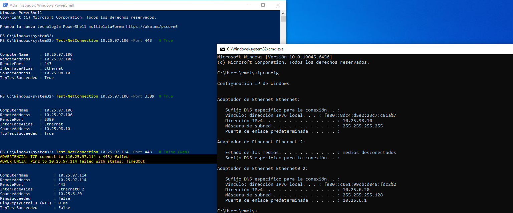
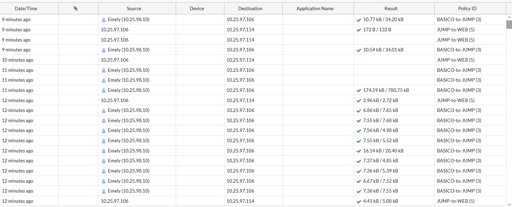
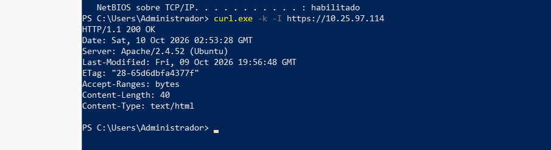
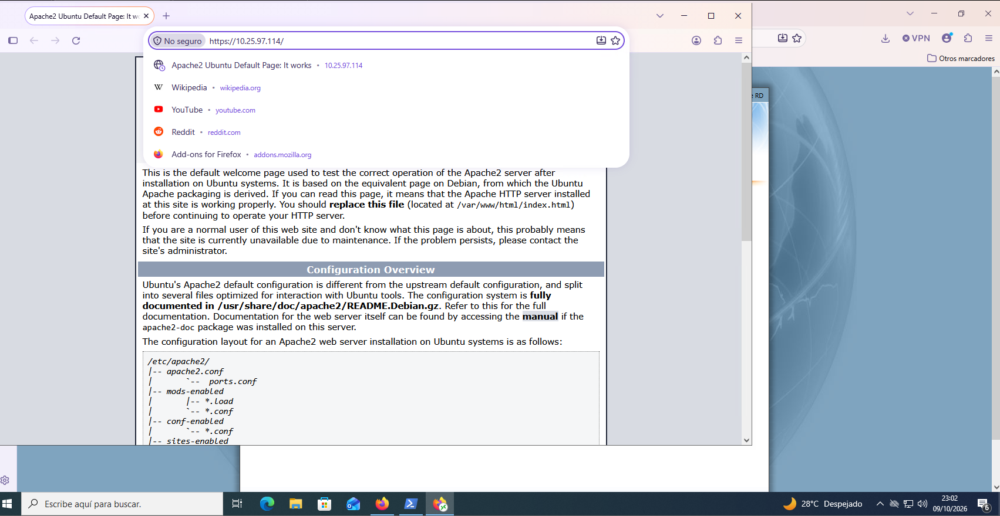
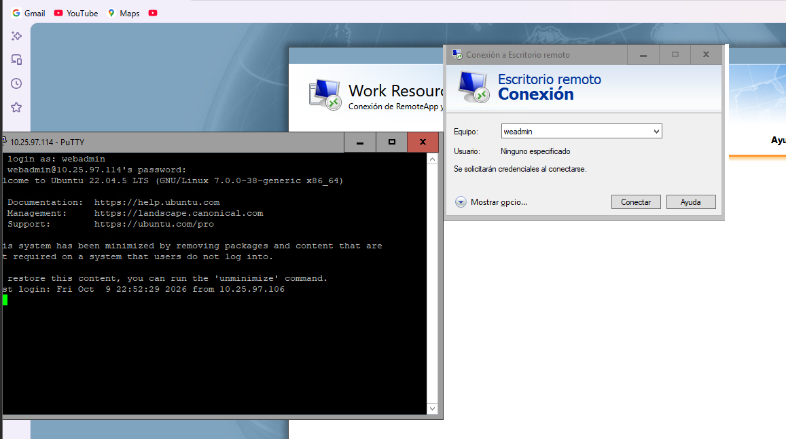
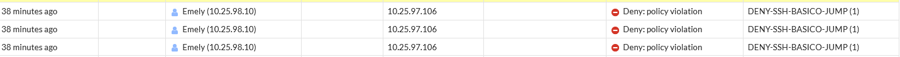

# 07 · Pruebas y validación

Estados: **Aprobada** (evidencia suficiente) · **Parcial** · **Ejecutada, no concluyente** (se hizo, pero no demuestra el requisito) · **Pendiente**. Tabla resumen: [`matrices/matriz-validacion.md`](../matrices/matriz-validacion.md).

## Acceso VPN

### T03 · Establecimiento de la VPN: Aprobada
- **Origen / destino:** cliente Windows 10 → FortiGate (20.25.97.2).
- **Resultado observado:** FortiClient conectado con 10.25.98.10 ([VPN-02](../evidencias/vpn/VPN-02-forticlient-conectado.png)); el monitor IPsec muestra Fase 1 y 2 activas ([VPN-03](../evidencias/vpn/VPN-03-monitor-ipsec.png)).

### T04 · VPN → Jump Server: Aprobada

*TEST-01. `Test-NetConnection 10.25.97.106` por 443 y 3389 con `SourceAddress 10.25.98.10`: `TcpTestSucceeded: True` en ambos.*

El mismo recuadro incluye una prueba al Web con origen 10.25.6.20, que **no** es válida para T05 (ver abajo).

*TEST-02. Log de tráfico: Emely (10.25.98.10) → 10.25.97.106 por BASICO-to-JUMP (3), y 10.25.97.106 → 10.25.97.114 por JUMP-to-WEB (5).*

El log confirma las dos políticas permitidas en uso. No incluye columna de servicio.

### T05 · VPN → Web denegado: **Pendiente**
Las capturas existentes ([TEST-12](../evidencias/pruebas-denegadas/TEST-12-cliente-lan-a-web-no-concluyente.png), [TEST-13](../evidencias/pruebas-denegadas/TEST-13-cliente-lan-a-web-no-concluyente.png)) muestran fallos de 443, 22 y ping hacia 10.25.97.114, pero con `SourceAddress 10.25.6.20` (LAN de usuarios). Ese tráfico no entra por la VPN y no pasa por las políticas `VPN-REMOTE`. Además, [VPN-04](../evidencias/vpn/VPN-04-ip-cliente-vpn.png) muestra que el adaptador del túnel no tiene gateway.

**Para cerrarla** (todo con el túnel activo, desde la GUI en el firewall): forzar una ruta al Web por el adaptador del túnel, repetir `Test-NetConnection 10.25.97.114` por 443, 22 y ping con `SourceAddress 10.25.98.10`, y capturar la denegación en *Log & Report → Forward Traffic*.

## Jump → Web

### T06 · HTTPS: Aprobada

*TEST-05. `curl.exe -k -I https://10.25.97.114` desde el Jump: HTTP/1.1 200 OK, Apache/2.4.52 (Ubuntu).*

*TEST-07. Firefox en el Jump con `https://10.25.97.114/` y la página "Apache2 Ubuntu Default Page".*

`-k` omite la validación del certificado, que no se ha documentado (el navegador marca "No seguro").
**Inconsistencia a aclarar:** el `curl` informa `Content-Length: 40` mientras que la página por defecto de Apache pesa alrededor de 10 KB. Puede ser un virtual host distinto entre HTTP y HTTPS o un archivo modificado. Ver T17.

### T07 · RDP: Parcial
`TcpTestSucceeded: True` al puerto 3389 ([TEST-04](../evidencias/pruebas-permitidas/TEST-04-jump-a-web-tcp-443-22-3389.png)) y xrdp escuchando ([RED-05](../evidencias/red/RED-05-xrdp-3389-web.png)). **Falta una sesión RDP establecida** con 10.25.97.114 visible.

### T08 · SSH: Aprobada

*TEST-08. PuTTY a 10.25.97.114: acceso como `webadmin`, Ubuntu 22.04.5 LTS, "Last login … from 10.25.97.106". TCP 22 también responde desde el Jump (TEST-04).*

### T15 · Servicio no autorizado Jump → Web: Ejecutada, no concluyente
[TEST-11](../evidencias/pruebas-denegadas/TEST-11-jump-a-web-445-no-concluyente.png) muestra fallo de TCP 445 y de ping. El Web no escucha en 445 ([RED-04](../evidencias/red/RED-04-puertos-escucha-web.png): solo 22, 80 y 443), por lo que el fallo no distingue puerto cerrado de bloqueo por política; y el Implicit Deny no registra.

## Perfiles de usuario

### T13 · Sin privilegios: SSH → Jump denegado: Aprobada

*TEST-10. Tres eventos "Deny: policy violation" de Emely (10.25.98.10) → 10.25.97.106 en DENY-SSH-BASICO-JUMP (1).*

El log no muestra el puerto; se atribuye a SSH por el nombre y el servicio de la política. El comando original que generó el tráfico no está capturado.

### T14 · Sin privilegios: SSH → Web denegado: **Pendiente**
La política `DENY-SSH-BASICO-WEB` tiene 0 B: nunca se ha activado.

### T11 / T12 · Aplicaciones por perfil: Parcial
Ver [05](05-jump-server-y-remoteapp.md#acceso-web-rd-web-access): configuración de asignaciones demostrada; falta la captura que vincule cada usuario con los iconos que ve y con la aplicación ejecutándose (PuTTY y mstsc en uso).

### T17 · Sistema de Caja: **Pendiente**
El Web publica la página por defecto de Apache ([TEST-06](../evidencias/pruebas-permitidas/TEST-06-jump-a-web-navegador-http.png), [TEST-07](../evidencias/pruebas-permitidas/TEST-07-jump-a-web-navegador-https.png)).
